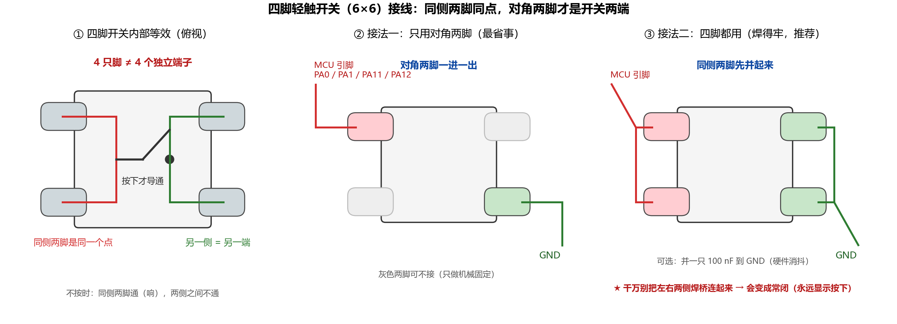

# 按键接线与引脚分配（主控节点 Security Watch）

> 对象：`Security Watch\`（可穿戴跌倒与疲劳检测系统的**主控节点 B**，STM32F103C8T6）
> 对应题面：要求（5）"本地蜂鸣告警与取消按钮（防误报）"
> 状态：**4 个按键已在 `.ioc` 中配置完毕**（GPIO 输入 + 内部上拉 + User Label），链路已逐项核对，
> 固件编译链接通过（见 `docs\GPS模块接入方案.md` §6.4）

---

## 1. 结论：4 个按键已经开好，无需再改 `.ioc`

| 按键 | MCU 引脚 | 板上常见丝印 | 固件宏（`main.h`） | **角色（菜单）** | 未按下 | 按下 |
|---|---|---|---|---|---|---|
| **KEY_1** | **PA0**（= WKUP） | `A0` | `KEY_1_Pin` / `KEY_1_GPIO_Port`(GPIOA) | **上** | 高（3.3 V） | **低（0 V）** |
| **KEY_2** | **PA1** | `A1` | `KEY_2_Pin` / `KEY_2_GPIO_Port`(GPIOA) | **下** | 高 | **低** |
| **KEY_3** | **PA11** | `A11`（Blue Pill 上即 USB D−） | `KEY_3_Pin` / `KEY_3_GPIO_Port`(GPIOA) | **确认** | 高 | **低** |
| **KEY_4** | **PA12** | `A12`（Blue Pill 上即 USB D+） | `KEY_4_Pin` / `KEY_4_GPIO_Port`(GPIOA) | **返回**（长按 = 取消告警） | 高 | **低** |

> 引脚分组刚好合用：**PA0/PA1 相邻**（上、下）、**PA11/PA12 相邻**（确认、返回），
> 布线时按"左边上下、右边确认返回"装按键，操作用起来最顺。

**四个键都在 GPIOA 上**，所以 CubeMX 生成的初始化只有一段（`gpio.c`）：

```c
/*Configure GPIO pins : KEY_1_Pin KEY_2_Pin KEY_3_Pin KEY_4_Pin */
GPIO_InitStruct.Pin  = KEY_1_Pin|KEY_2_Pin|KEY_3_Pin|KEY_4_Pin;
GPIO_InitStruct.Mode = GPIO_MODE_INPUT;
GPIO_InitStruct.Pull = GPIO_PULLUP;      /* 内部上拉已打开 */
HAL_GPIO_Init(GPIOA, &GPIO_InitStruct);
```

配置链路核对结果（4 项全部一致，无缺口）：

| 环节 | 内容 | 状态 |
|---|---|---|
| `Security Watch.ioc` | `PA0-WKUP/PA1/PA11/PA12` → `Signal=GPIO_Input`、`GPIO_PuPd=GPIO_PULLUP`、`GPIO_Label=KEY_1..KEY_4`、`Locked=true` | ✅ |
| `Core\Inc\main.h` | `KEY_1_Pin GPIO_PIN_0` … `KEY_4_Pin GPIO_PIN_12`，端口均为 `GPIOA` | ✅ |
| `Core\Src\gpio.c` | 四键一段 `HAL_GPIO_Init`，`GPIO_MODE_INPUT` + `GPIO_PULLUP` | ✅ |
| `MDK-ARM\icode\driver\key.c` | `Key_GetState()` 分别读 `KEY_1..KEY_4`，`RESET`(低) 判定按下并返回 1~4 | ✅ |

> 历史原因：`KEY_3/KEY_4` 原来在 **PA2/PA3**，为了让出 PA2/PA3 给 **USART2（HC-08 BLE）**，
> 已迁到 **PA11/PA12**（见 `docs\GPS模块接入方案.md` §4.4）。

---

## 2. 接线

### 2.1 接线表

| 从（MCU） | 到 | 说明 |
|---|---|---|
| PA0（KEY_1） | 按键1 的一端 | 按键1 另一端 → **GND** |
| PA1（KEY_2） | 按键2 的一端 | 按键2 另一端 → **GND** |
| PA11（KEY_3） | 按键3 的一端 | 按键3 另一端 → **GND** |
| PA12（KEY_4） | 按键4 的一端 | 按键4 另一端 → **GND** |
| GND | 四个按键的公共端 | **必须与 MCU 共地** |

**不需要任何外部上拉电阻**：四个引脚的内部上拉已在 `gpio.c` 里打开（典型 30~50 kΩ）。
按键用**常开轻触开关**，一端接引脚、一端接 GND 即可；按下时引脚被拉到 0 V，松开时被内部上拉拉回 3.3 V。

### 2.2 接线示意图

```
             主控节点 B（STM32F103C8T6）
        ┌──────────────────────────────────────────┐
        │  PA0/WKUP     PA1      PA11      PA12     │
        └────┬──────────┬─────────┬─────────┬───────┘
             │          │         │         │
           ┌─┴─┐      ┌─┴─┐     ┌─┴─┐     ┌─┴─┐
           │KEY│      │KEY│     │KEY│     │KEY│      常开轻触开关
           │ 1 │      │ 2 │     │ 3 │     │ 4 │     （无需外部电阻）
           └─┬─┘      └─┬─┘     └─┬─┘     └─┬─┘
             └──────────┴─────────┴─────────┘
                            │
                           GND   ←─ 与 MCU 共地（必接）
```

### 2.3 四脚轻触开关（6×6）怎么接 —— 最常见的那个坑



**规则：同一个内部金属片上的两只脚是同一个点；对角的两只脚才是开关的两端。四只脚 ≠ 四个独立端子。**

把同侧两脚当成两个端子接进去 = **常闭**，那个键会永远显示"按下"（检测页里 `[#]` 常亮、`RAW` 恒为 0）。

**30 秒验证（万用表通断/蜂鸣档，不按键时）**：

| 测哪两脚 | 应该 |
|---|---|
| 同一侧的两脚 | **响**（0 Ω）→ 同一个点 |
| 对角 / 左右两侧两脚 | **不响**（开路） |
| 按住后再测两侧 | **响** → 这就是开关的通断 |

若量出来"同侧不响、对角反而响"，说明你那颗是四脚在四角的排列 —— **以实测为准**，规则不变：不按就相通的两脚是同一个点。

**两种焊法**：
- 省事（图中②）：只焊**对角两脚**，另两脚留空仅作机械固定；
- 推荐（图中③）：**同侧两脚先并起来**（左侧两脚一起 → MCU 引脚，右侧两脚一起 → GND），4 个焊点都受力，按键不易晃。

**要点**：
1. ⚠ 千万不要把**左右两侧**焊桥连起来 → 会变常闭；
2. **无需外部上拉电阻**（`gpio.c` 里内部上拉已开，按下 = 低电平）；
3. 引线 >20 cm 时，在按键**两端（引脚 ↔ GND）之间**并一只 **100 nF** 硬件消抖；
4. 4 个键的 GND 脚可以串成一条公共地线，最后统一接回主板 GND。

**接完自检（对照 §3.6 检测页）**：

| 现象 | 结论 |
|---|---|
| 按住 → `RAW` 对应位 1→0、`[#]` 亮 | ✅ 接对 |
| 不按也一直 0 / `[#]` 常亮 | ❌ 左右两侧被焊桥短路（或线错接到 GND） |
| 按下 `RAW` 不变 | ❌ 虚焊 / 接到了同侧的另一只脚上 |
| `SCAN` 不涨 | 与接线无关：扫描任务（`alarm_task`）没在跑 |

### 2.4 电气注意

1. **PA0/PA1 不是 5 V 耐受引脚**（属模拟/ADC 域）：接按键到 GND 没问题，但**不要**把 5 V 引到这两个脚上。
   PA11/PA12 是 FT（5 V 耐受）引脚。
2. **PA11/PA12 与 USB 复用**：如果你用的是 Blue Pill 类板子，这两个脚同时接到 USB 座。本项目**不用 USB**，
   用作按键没有冲突；注意部分板子在 PA12 上有 1.5 kΩ 上拉（USB 枚举用），它比内部上拉更强，
   但按键按下时仍能被拉到 0 V，逻辑不受影响。
3. **引线较长时**（>20 cm，可穿戴形态很常见）建议在每个按键两端并一只 **100 nF** 电容做硬件消抖，
   固件里再叠一层 20 ms 软件消抖（见 §3）。
4. SPI/I2C 排线（IMU 板、OLED）与按键线分开走，避免按键抖动耦合进 IMU 采样。

---

## 3. 固件侧怎么用（按键驱动已升级为"事件"模型）

分工（用户定稿，做 OLED 菜单导航）：

| 按键 | 引脚 | 角色 | 短按 | 长按 |
|---|---|---|---|---|
| KEY_1 | PA0 | **上** | `KEY_EVENT_UP` | 连发 `KEY_EVENT_UP_REPEAT` |
| KEY_2 | PA1 | **下** | `KEY_EVENT_DOWN` | 连发 `KEY_EVENT_DOWN_REPEAT` |
| KEY_3 | PA11 | **确认** | `KEY_EVENT_OK` | — |
| KEY_4 | PA12 | **返回** | `KEY_EVENT_BACK` | `KEY_EVENT_BACK_LONG`（建议映射为"取消告警"） |

时序（全部以 `Key_Scan()` 的调用周期 10 ms 为基准，写在 `key.c` 顶部宏里，可直接改）：

```
按下 ──30 ms 消抖──▶ 按下沿立即出"短按"事件 ──按住 500 ms──▶ 起连发，每 150 ms 一次（仅上/下键）
                                              └──按住 1000 ms──▶ 出"长按"事件（返回键）
```

### 3.1 接口（`icode\driver\key.c` / `key.h`）

```c
#include "key.h"

void        Key_Init(void);              /* 清内部状态（引脚已由 MX_GPIO_Init 配好） */
void        Key_Scan(void);              /* 每 10 ms 调一次，只允许一个调用者 */
Key_Event_t Key_PeekEvent(void);         /* 看队首事件，不取走 */
Key_Event_t Key_GetEvent(void);          /* 取走队首事件；无事件返回 KEY_EVENT_NONE */
uint8_t     Key_GetState(void);          /* 兼容旧接口：0=无；1~4=当前按住的键号（消抖后） */
uint8_t     Key_GetNum(void);            /* 兼容旧接口：取最近一次按下的键号并清零 */
```

### 3.2 菜单任务怎么写

```c
/* 菜单任务（或 alarm_task）里：先扫描，再消费事件 */
Key_Scan();
switch (Key_GetEvent())
{
    case KEY_EVENT_UP:    menu_move(-1); break;
    case KEY_EVENT_DOWN:  menu_move(+1); break;
    case KEY_EVENT_UP_REPEAT:   menu_move(-1); break;   /* 长按快速滚动 */
    case KEY_EVENT_DOWN_REPEAT: menu_move(+1); break;
    case KEY_EVENT_OK:    menu_enter();  break;
    case KEY_EVENT_BACK:  menu_back();   break;
    default: break;
}
```

**两条纪律**（写在 `key.h` 里了）：
1. `Key_Scan()` 全工程**只能有一个调用者**，否则按住时长会被算两遍，长按与连发全部失准；
2. 事件队列是"单生产者（`Key_Scan` 调用者）/ 单消费者（取事件的任务）"模型。若告警逻辑与菜单在不同任务里，
   告警侧用 `Key_PeekEvent()` **只看不取**，确认是给自己的再 `Key_GetEvent()` 取走。

### 3.3 当前已经接好：`alarm_task` 每 10 ms 扫一次

`icode\task\alarm_task.c` 本来就是 10 ms 的空转桩，且按题面它负责"取消按钮"，所以把扫描放在那里：

```c
Key_Init();                 /* 任务初始化时一次 */
for (;;)
{
    Key_Scan();                                        /* 10 ms 一拍 */
    if (Key_PeekEvent() == KEY_EVENT_BACK_LONG)        /* 只看不取 */
    {
        (void)Key_GetEvent();                          /* 确认给自己才取走 */
        /* TODO: PENDING → CANCELLED，停鸣叫，记误报样本 */
    }
    /* TODO: 告警状态机 */
    vTaskDelay(pdMS_TO_TICKS(10));
}
```

> 将来新增 `menu_task` 时，把 `Key_Scan()` 挪进 `menu_task` 即可（保持只有一个调用者）。

### 3.4 题面要求（5）"取消按钮"怎么落

4 个键都给了菜单导航，所以取消告警用**长按"返回"键**（`KEY_EVENT_BACK_LONG`，1 s）——
比短按更防误触，符合"防误报"的题意；答辩时也可以说"短按返回退出菜单、长按返回取消告警"。
若你更想要"告警期间任意键都取消"，改 `alarm_task` 那一处判断即可（`Key_PeekEvent() != KEY_EVENT_NONE`）。

### 3.5 本次对 `key.c` 做的改动

- 新增：30 ms 消抖、按下沿事件、长按/连发、8 深度事件队列、`Key_PeekEvent()`；
- **修好旧缺陷**：原 `Key_GetNum()` 恒返回 0（`Key_Num` 只有定义与清零，旧 `Key_Tick()` 被注释掉了），
  现在由按下沿锁存，取走即清零；
- `Key_GetState()` 改用**消抖后**的稳定电平（原来直读引脚，抖动时会误判）；
- 分工写在 `key.c` 顶部的 `s_map[]` 表里，改角色只改这张表；
- ⚠ `key.c` / `key.h` 保持 **GBK 编码**（Keil 默认编辑器就是 GBK，中文注释不会乱码）；
  改造前的原版备份在同目录 `key.c.bak-before-menu`、`key.h.bak-before-menu`。


### 3.6 三个屏幕的切换（按键检测页 / GPS 接收页 / DIY IMU 页）

`icode\task\oled_task.c` 里现在**三个屏幕共存**，用文件顶部的开关切换：

```c
#define OLED_SCREEN_IMU         0      /* DIY IMU 链路状态页（三页轮换） */
#define OLED_SCREEN_KEYTEST     1      /* 按键检测页 */
#define OLED_SCREEN_GPS         2      /* GPS 接收页 */
#define OLED_SCREEN_SEL         OLED_SCREEN_GPS   /* ★ 只改这一行 */
```

另外两套绘图代码都用 `#if` 包着、**未被删改**，改回对应编号即可切换。

**在 GPS 接收页里，"上/下"键就是翻页键**（上=上一页，下=下一页，循环，长按可连发快速翻）：

| 页 | 内容 | 用途 |
|---|---|---|
| `1/3` 链路 | `ALIVE/LOST`、`RX`、**语句普查 `RMC/GGA/GSV/GSA/OTH/CSE`**、最近一条语句原文 | 判断串口有没有数据、波特率对不对、**模块缺哪种语句** |
| `2/3` 卫星 | `FIX`、`Q`、`ST used`、`VW view`、`MX dBHz`、`AGE` | **判断天线/视野**：VW/MX 全 0 = 射频没信号 |
| `3/3` 位置 | `LAT`、`LON`、`ALT`、`HDOP`、`SPD km/h`、`UTC` | 定位解算结果 |

实现上，翻页消费的是 `Key_TakeNav()`（按键驱动里为导航单独做的锁存），
**不占用事件队列**，所以 `alarm_task` 那条"长按返回 = 取消告警"的队列消费完全不受影响，
也不会出现两个任务抢同一队列的情况。详见 `key.h` 里 `Key_TakeNav()` 的说明。

画面（128×64，6×8 字体，每行 21 字符）：

```
KEY TEST        EV B-LNG
1 UP   [ ]  N 0000  L 00
2 DOWN [ ]  N 0000  L 00
3 OK   [ ]  N 0000  L 00
4 BACK [ ]  N 0000  L 00
RAW 1 1 1 1   HLD 0000ms
SCAN 0001234  EVT 0007
HEAP 0001234
```

| 行 | 含义 | 怎么用它排故障 |
|---|---|---|
| `EV` | 最近一次事件名（5 字符定宽，无残留） | 短按 → `UP`/`DOWN`/`OK`/`BACK`；按住返回 1 s → `B-LNG`；按住上/下 0.5 s 后 → `U-REP`/`D-REP` |
| `[#]` / `[ ]` | 消抖后的按下状态 | 按下立刻变 `[#]`；按下去没反应就先看 `RAW` 行 |
| `N` | 累计**按下次数** | 按 5 下应加 5；一次按出多次 → 抖动，加 100 nF 硬件消抖 |
| `L` | 累计**长按次数** | 验证 1000 ms 长按阈值 |
| `RAW` | **消抖前**的引脚电平：`1`=松开，`0`=按下 | **接线排查主力**：不按时四位全 `1`；按住某个键，对应位必须变 `0`。哪一位不变，就是这个键的线/引脚/上拉有问题 |
| `HLD` | 当前按住时长（四键取最大） | 看着它涨到 1000 后 `L` 计数 +1 |
| `SCAN` | `Key_Scan()` 累计调用次数 | **应约 100/秒稳定增长**。这个数不动 = 扫描方（当前 `alarm_task`）没在跑，屏幕其它数字自然也不动 —— 一眼区分"按键坏"还是"扫描没跑" |
| `EVT` | 累计产生的事件数 | 菜单还没接时它只会一直涨；菜单接上后会稳定在较小值 |
| `HEAP` | 系统可用堆（字节） | 任务创建失败多是堆不够，现场直接看这一行 |

**切回 IMU 页**：把 `OLED_SCREEN_KEY_TEST` 改成 `0` 重新编译即可。
IMU 那套绘图代码（三页轮换、定点显示 `OLED_ShowScaled`、CRC/丢帧诊断）**原样保留**，
只是用 `#if !OLED_SCREEN_KEY_TEST` 包起来不参与编译，切回 0 就回来。

按键页读的都是 `key.c` 的**只读自检接口**（`Key_GetRawMask` / `Key_GetPressCount` / …），
**不消费事件队列**，所以菜单/告警的事件流不受影响；`Key_Scan()` 也仍然只在 `alarm_task` 里调用（保持单调用者）。

> 编译占用（实测，`tools\armcc_build_check.py`）：
> 按键检测页 **Flash 33.48 KB / RAM 18.77 KB**；IMU 页 **Flash 34.09 KB / RAM 18.73 KB**
> —— 按键页反而更小，因为 IMU 页的三页绘图与定点换算代码体积更大。

---

## 4. 备用按键与"可回收"引脚

| 引脚 | 现状 | 可否当按键 |
|---|---|---|
| **PB12** | `Encoder_button`：GPIO_Input + 上拉（编码器驱动已删，但引脚配置还在） | ✅ **现成可用**，另一头接 GND 就是第 5 个按键，`main.h` 里宏名 `Encoder_button_Pin` |
| PB13 | `DHT11`：GPIO_Output 开漏（DHT11 驱动已删） | 需在 CubeMX 里改成 `GPIO_Input` + 上拉 |
| PA15 / PB3 | TIM2 编码器接口（驱动已删） | 需先在 CubeMX 里释放 TIM2 |
| PB4 / PB5 | `SWITCH_1/2`：当前配置为**输出** | 需在 CubeMX 里改成输入 |
| **PA8 / PA9 / PB15 / PC13** | **完全空闲** | ✅ 可直接新增按键 |

---

## 5. 完整引脚占用表（避免接线冲突）

| 引脚 | 功能 | 引脚 | 功能 |
|---|---|---|---|
| PA0 | **KEY_1** | PB0 / PB1 | TIM3_CH3/CH4（PWM 调光） |
| PA1 | **KEY_2** | PB3 | TIM2_CH2（编码器，驱动已删） |
| PA2 / PA3 | **USART2**（HC-08 BLE） | PB4 / PB5 | SWITCH_1 / SWITCH_2（输出） |
| PA4 / PA5 | ADC1_IN4/IN5 | PB6 / PB7 | **USART1**（GPS，重映射） |
| PA6 / PA7 | TIM3_CH1/CH2（PWM） | PB8 / PB9 | OLED（软件 I2C） |
| PA8 / PA9 | 🟢 空闲 | PB10 / PB11 | **USART3**（节点 A 链路） |
| PA10 | TIM1_CH3（**已空闲**，ws2812b 驱动已删除） | PB12 | Encoder_button（输入，可当按键） |
| PA11 | **KEY_3** | PB13 | DHT11（输出，驱动已删） |
| PA12 | **KEY_4** | PB14 | **BEEP**（低电平触发） |
| PA13 / PA14 | SWD 调试（勿动） | PB15 | 🟢 空闲 |
| PA15 | TIM2_CH1（编码器，驱动已删） | PC13 | 🟢 空闲 |
| PC14 / PC15 | LSE 晶振（RTC） | PD0 / PD1 | HSE 晶振 |

🟢 = 空闲可用；**加粗** = 本课题在用。

---

## 6. 如果想换一组引脚（备选方案）

当前 4 键是 **PA0、PA1、PA11、PA12**：都在 GPIOA，但**在排针上不连续**（A0/A1 在一端，A11/A12 在另一端）。

若你希望 4 个按键排成一排、方便一根 5 芯排线（4 信号 + GND）接出去，推荐改成
**PA8 / PA9 / PA11 / PA12**（Blue Pill 左排 A8~A12 相邻，中间只跳过 A10；A10 现已空闲）：

| 优点 | 代价 |
|---|---|
| 4 个按键物理相邻，接线整洁 | 要在 CubeMX 里改 4 个引脚的 User Label（`main.h` 由 CubeMX 重生成；`gpio.c` 因同属 GPIOA **不用改**） |
| 让出 PA0/PA1（ADC_IN0/IN1，可留给电池电压检测） | 已按当前引脚焊好的话要重新接线 |

**改法**（若确定要换，告诉我，我直接改 `.ioc` 并同步 `main.h`）：
1. `.ioc` 里把 PA0-WKUP/PA1 的 `GPIO_Label` 去掉（`Reset_State`），PA8/PA9 设为 `GPIO_Input` + `GPIO_PULLUP` + Label `KEY_1`/`KEY_2`；
2. 生成后确认 `main.h` 中 `KEY_1_Pin=GPIO_PIN_8`、`KEY_2_Pin=GPIO_PIN_9`；
3. 其余（`gpio.c`、`key.c`、接线方式）不变。

---

## 7. 已定事项与后续

**已定（本次）**

- [x] 引脚：**保持 PA0 / PA1 / PA11 / PA12**（不动 `.ioc`，不重做已验证的配置）；
- [x] 分工：**KEY_1=上、KEY_2=下、KEY_3=确认、KEY_4=返回**（做 OLED 菜单导航）；
- [x] 驱动：`key.c` 升级为"消抖 + 事件"模型，`Key_GetNum()` 恒 0 的老问题已修（见 §3.5）；
- [x] 扫描点：`alarm_task` 每 10 ms 调一次 `Key_Scan()`，并已接好"长按返回 = 取消告警"的判断；
- [x] 编译链接校验通过：`tools\armcc_build_check.py` → Flash **34.09 KB**、RAM **18.73 KB**（余 1.3 KB）。

**后续（等你说做哪一步）**

- [ ] **菜单本体**：OLED 多级菜单（主页 / 状态页 / 设置页 / 校准页）。按键事件已经在等你消费。
      建议新增一个 `menu_task`（低优先级，与 OLED 刷新放同一任务，避免抢软件 I2C 总线），
      并把 `Key_Scan()` 从 `alarm_task` 挪进 `menu_task`（保持只有一个调用者）。
- [ ] **告警状态机**：`alarm_task` 里 IDLE → PENDING → CANCELLED / CONFIRMED（取消窗口 20 s、冷却 120 s），
      取消条件直接用已接好的 `KEY_EVENT_BACK_LONG`。
- [ ] 丝印/面板：按"左=上/下、右=确认/返回"布置即可，固件无需再改。
